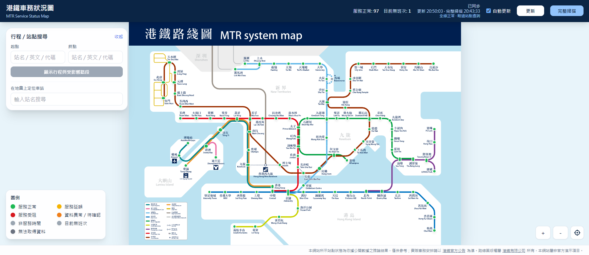

# MTR Station Status Map


 &nbsp;
 &nbsp;
 &nbsp;
[](LICENSE)

**See all 98 MTR stations coloured by live service status on the official map.**

[Live demo](https://mtr-station-status-map.onrender.com) · [DATA.GOV.HK](https://data.gov.hk/) · [How it works](#how-it-works)

Unofficial demo · statuses inferred from public APIs, not official announcements · map artwork © MTR Corporation Limited

## How it works

- **Desktop** — full system map with 98 coloured station anchors, a journey panel, station search, and a status legend.
- **Mobile (<640px)** — the map rotates 90° and covers the screen; the journey panel, zoom buttons and footer are hidden. Use one-finger drag to pan, pinch to zoom, and double-tap to reset. The toolbar collapses into a single row with a `⋯` menu, and the legend becomes a floating button.

The tab icon follows the worst network status: **red** (disruption), **yellow** (delay), **orange** (data unavailable), **grey** (≥50% of stations non-service), otherwise **green**.

## Features

### Status inference

- Station-level status inference from the Next Train API and RYG line feed, with cautious wording for data absence.
- Dynamic favicon built from the supplied train SVG, coloured from the app's status palette.

### Map and interaction

- 98 measured anchors in the SVG viewBox; interchange stations use capsule-shaped markers, ordinary stations use circles. Markers are opaque with a white outline.
- Journey planner (desktop): Dijkstra over the line topology with an interchange penalty, affected-station list, and blue rings on route stations. No connecting polylines.
- Station search / locate: Chinese name, English name or station code; suggestions render in a portal dropdown with keyboard support.
- Station detail popover: per-line status, next three trains in a aligned table (destination / minutes / platform), official alert link.
- PWA basics: manifest, favicon and theme colour.

### Server and polling

- Server-owned snapshot: the Node server polls both upstream APIs once for all visitors and keeps one in-memory snapshot. Each client reads it with a single request, so the map is coloured as soon as that snapshot arrives and request volume does not grow with traffic.
- Low-volume polling: RYG-first adaptive plan; 0 station calls when all lines are green and data is complete, ~2 requests/s rolling refresh (121 pairs ≈ 60 s), 10 min full sweep, 3 min RYG cache.
- 429 handling: one brief retry per station; on a sustained throttle the server pauses the queue but keeps (and marks stale) every observation, and repairs incomplete lines on the next cycle.
- Compressed snapshot: `/api/snapshot` is gzip-encoded when the client accepts it, keeping the 10 s poll cheap on mobile connections.
- Production server that serves `dist/`, owns the aggregator and exposes `/api/snapshot`, `/api/refresh` and `/api/full-scan`.

### Resilience

- Until the first server snapshot arrives the map shows an explicit loading overlay instead of grey markers; the snapshot is prefetched before React mounts, with localStorage as a fallback; a green RYG line is painted provisionally until station data arrives; stale-while-revalidate keeps last good data, failed refreshes never blank the map, ErrorBoundary fallback.
- Action throttling: repeated `refresh` / `full-scan` presses are ignored inside a 10 s / 60 s window, so user clicks cannot multiply upstream requests.

Unit tests cover status inference, journey planning, aggregator scheduling/throttling, API parsing and favicon rules.

### UI controls

- **Desktop**: drag to pan, scroll to zoom, `←/→/↑/↓` to pan, `+` / `-` to zoom, `Esc` or the target button to reset; `Update` asks the server to refresh RYG plus urgent/incomplete lines, `Full Scan` asks for a full 121-pair sweep (at most once every 60 s). Both buttons show immediate busy feedback.
- **Mobile**: one-finger pan, pinch zoom, double-tap reset, `⋯` menu for auto-refresh / full scan, floating legend toggle.
- **Journey panel**: type or search `From` / `To`, press Enter to pick a suggestion, then `Show Route and Affected Road Sections`.

## Data sources

| Source | Endpoint | Purpose |
| --- | --- | --- |
| Next Train API (DATA.GOV.HK / MTR) | `https://rt.data.gov.hk/v1/transport/mtr/getSchedule.php` | Per-station `isdelay`, `status`, `message` and upcoming trains |
| RYG line status feed | `https://tnews.mtr.com.hk/alert/ryg_line_status.xml` | Line-level green / yellow / red / grey and non-service hours |

Both endpoints are called **only by the server aggregator**. The Next Train API accepts one line/station pair per request (no batch endpoint exists), so a full sweep is 121 requests; the aggregator spaces them at ~500 ms to stay below CDN throttling thresholds. Clients never touch these endpoints directly.

### Polling strategy

| Setting | Value |
| --- | --- |
| Server sweep | rolling, ~2 requests/s (500 ms spacing) |
| Client snapshot poll | every 10 s (one request per client) |
| RYG cache | 180 s |
| Full sweep | every 10 min (121 pairs), yellow/red lines prioritised |
| First paint | static splash in `index.html` from the first byte; snapshot is prefetched before React mounts; loading overlay stays until RYG data arrives |
| Action throttling | refresh ≥10 s apart, full scan ≥60 s apart; duplicate presses return the current snapshot |
| Snapshot encoding | gzip when `Accept-Encoding: gzip` is present |
| HTTP 429 | 1 retry per station honouring `Retry-After` (capped at 1.5 s); short server-side pause keeps every observation and marks it stale; incomplete lines repaired next cycle |

## Status inference

| API condition | Marker |
| --- | --- |
| `status = 0` + suspended / closed | Red — disruption |
| `status = 0` + special-arrangement URL | Amber |
| `isdelay = Y` with train data | Yellow — delay |
| `isdelay = Y` without train data | Orange — data unavailable / unconfirmed |
| `isdelay = N` with train data | Green — normal |
| `isdelay = N` without trains | Grey — no trains at present |
| RYG `grey` | Grey — non-service hours |
| RYG `green` with no station data yet | Green — provisional first paint, replaced as soon as observations arrive |
| Stale observation | Grey — 「Data Expired」, last known status kept in the popover |

Interchange stations show one marker with the worst status among their lines.

## Quickstart

```bash
git clone https://github.com/alvinau0427/mtr-station-status-map.git
cd mtr-station-status-map
npm install
npm run dev      # http://localhost:5173 (development, HMR)
npm test         # unit tests
npm run build    # production build in dist/
npm start        # http://localhost:8787 (built app + server snapshot)
```

With Docker:

```bash
docker build -t mtr-status .
docker run -p 8787:8787 mtr-status
```

`npm run dev` mounts the same aggregator as a Vite middleware; `npm start` uses `server/line-status-proxy.js`, which serves `dist/`, owns the aggregator and exposes the snapshot endpoints in one process.

## API endpoints

| Endpoint | Purpose |
| --- | --- |
| `GET /api/snapshot` | Current in-memory snapshot (never blocks on upstream) |
| `POST /api/refresh` | Force an RYG refresh plus urgent/incomplete lines (≥10 s apart), return the snapshot immediately |
| `POST /api/full-scan` | Force a full 121-pair sweep (≥60 s apart), return the snapshot immediately |

This design needs a long-lived Node process. For serverless hosting, replace the in-memory aggregator with a scheduled function that writes the snapshot to shared storage.

## Project structure

```
src/
├── assets/train.svg         # Train glyph for the favicon
├── components/              # Map, popover, toolbar, legend, journey panel, dropdown
├── data/                    # Lines/stations metadata, measured anchors and shapes
├── domain/                  # Pure status inference and journey planner
├── hooks/useStatusSync.ts   # Snapshot polling, first-paint cache, batch commits
├── services/snapshotApi.ts  # Server snapshot client
├── utils/                   # Dynamic favicon generation
├── App.tsx
└── main.tsx
public/                      # routemap.svg, favicon.svg, manifest.webmanifest
shared/lines.json            # Line/station codes shared by client and server
server/
├── aggregator.js            # Upstream polling, snapshot store, 429 handling
├── aggregator.test.js
└── line-status-proxy.js     # Static server + snapshot endpoints
```

## Limitations

- No Light Rail data (not covered by the Next Train API).
- No structured disruption reason, affected segment or recovery time — only free-text `message` and an optional official URL.
- No typhoon signal support (not present in the available feeds).
- Station status is inferred and may differ from the official line-level display.
- Mobile hides the journey planner to keep the map readable.

## License and attribution

The source code is released under the [MIT License](LICENSE). Third-party materials (the MTR system map, train glyph and public API data) are **not** covered by the MIT License — see [NOTICE](NOTICE).

This is a **non-commercial demonstration project**. The MTR route map artwork (`public/routemap.svg`) is the property of MTR Corporation Limited. Obtain permission or replace the background with an independently drawn map before publishing.

Station colours are inferred from per-station next-train data (`isdelay`, `status`, `message`) plus the line-level RYG feed. They may differ from the official MTR service-status display. Light Rail is not covered by the Next Train API and therefore has no markers.

Station and arrival data come from [DATA.GOV.HK](https://data.gov.hk/) and MTR public APIs. The MTR system map is copyright of MTR Corporation Limited — see the [official system map page](https://www.mtr.com.hk/en/customer/services/system_map.html) and [MTR announcements](https://www.mtr.com.hk/).
